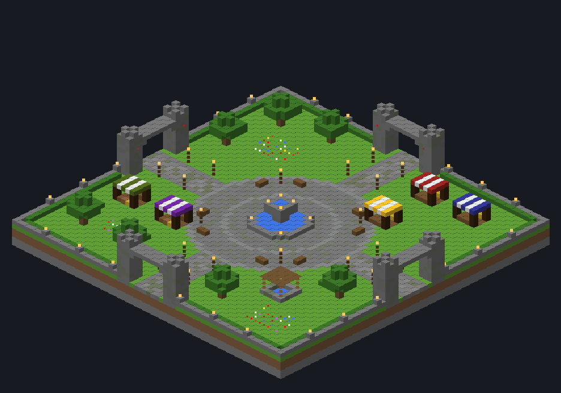

# minecraft-faction

Kit d'installation d'un serveur **Minecraft PvP Faction**, inspiré de LifeCraft, pour jouer entre potes sur un cluster Proxmox.

- **Serveur** : Paper 26.2 (supportée par FactionsUUID 4.7+ et OldCombatMechanics 2.6.0+)
- **Combat** : PvP 1.8 (pas de cooldown d'attaque, blocage à l'épée, etc.) grâce à OldCombatMechanics
- **Clients acceptés** : de la 1.8 à la dernière version, via ViaVersion, ViaBackwards et ViaRewind
- **Accès** : whitelist activée, seuls les joueurs ajoutés peuvent se connecter

## Plugins installés

| Plugin | Rôle |
|---|---|
| FactionsUUID | Factions, claims, power, raids |
| OldCombatMechanics | Mécaniques de combat 1.8 |
| ViaVersion / ViaBackwards / ViaRewind | Connexion depuis toutes les versions, de la 1.8 à la dernière |
| EssentialsX (+ Spawn, Chat) | /home, /tpa, /spawn, kits, économie |
| LuckPerms | Grades et permissions |
| Vault | Lien entre l'économie et les permissions |
| CoreProtect | Journal de chaque bloc posé, cassé ou coffre ouvert : rollback des griefs, preuves |
| GrimAC | Anti-cheat compatible ViaVersion (alertes seulement, voir plus bas) |
| Chunky | Pré-génération de la carte |
| LifeKoth | Events King of the Hill (plugin du kit) |

`install.sh` récupère **la dernière version de chaque plugin au moment où il tourne** : via Modrinth, Hangar ou GitHub Releases selon le plugin. Les checksums sont vérifiés quand la source les fournit. Si un plugin est introuvable, le script le signale à la fin sans s'interrompre.

### FactionsUUID : téléchargement manuel

FactionsUUID n'est publié que sur SpigotMC, qui bloque les téléchargements automatiques. Il faut donc le récupérer une fois à la main :

1. Sur ton PC, récupère le jar sur https://www.spigotmc.org/resources/factionsuuid.1035/ (plugin payant depuis la 4.x ; le code reste open source sous GPLv3 sur https://github.com/drtshock/Factions si tu préfères le compiler toi-même).
2. Envoie-le dans le conteneur sous le nom `FactionsUUID.jar`, par exemple depuis l'hôte Proxmox :
   ```bash
   pct push 200 FactionsUUID-x.y.z.jar /opt/minecraft/plugins/FactionsUUID.jar
   ```
3. Dans le conteneur :
   ```bash
   chown minecraft:minecraft /opt/minecraft/plugins/FactionsUUID.jar
   systemctl restart minecraft
   ```

Les relances suivantes de `install.sh` conservent ce jar ; pour le mettre à jour, remplace-le de la même façon.

## Prérequis

- Une VM ou un conteneur LXC **Debian 12 ou 13** sur Proxmox
- **4 à 6 Go de RAM** pour le serveur (prévois 1 Go de plus pour le système)
- 2 à 4 vCPU : Minecraft profite surtout d'une **fréquence élevée**, plus que d'un grand nombre de cœurs
- 20 Go de disque minimum (le monde et les sauvegardes grossissent avec le temps)
- Un accès Internet sortant

> **LXC ou VM ?** Un conteneur LXC non privilégié suffit et consomme moins. Choisis une VM si tu préfères isoler complètement le serveur.

## Installation

Dans la VM ou le conteneur, en root :

```bash
apt update && apt install -y git
git clone https://github.com/PolishMen25/minecraft-faction.git
cd minecraft-faction
./install.sh
```

Tu peux changer les réglages en les passant devant la commande :

```bash
RAM=6G MC_VERSION=26.2 ./install.sh
```

| Variable | Défaut | Rôle |
|---|---|---|
| `MC_VERSION` | `26.2` | Version de Paper / Minecraft. Ne la monte que quand tous les plugins supportent la nouvelle version |
| `RAM` | `5G` | Mémoire allouée à Java |
| `JAVA_VERSION` | `25` | Version de Java (Temurin) |
| `MC_DIR` | `/opt/minecraft` | Dossier du serveur |
| `EULA` | *(question)* | Mets `true` pour accepter l'EULA Mojang sans qu'on te la demande |

Le script :
1. installe Java (Temurin) et les outils nécessaires ;
2. crée l'utilisateur système `minecraft` et le dossier `/opt/minecraft` ;
3. télécharge le dernier build stable de Paper et vérifie son checksum ;
4. télécharge les plugins ;
5. installe la configuration de départ (`server.properties`) ;
6. crée le service systemd `minecraft` (démarrage automatique) et une sauvegarde quotidienne à 5 h ;
7. démarre le serveur.

**Pour tout mettre à jour plus tard**, relance `./install.sh`. Il remplace Paper et les plugins par leurs dernières versions, mais **ne touche jamais à tes configs ni à ton monde**.

## Premier démarrage

Le premier lancement génère le monde, ce qui prend 1 à 3 minutes. Suis-le avec :

```bash
tail -f /opt/minecraft/logs/latest.log
```

Quand `Done (xx.xxxs)! For help, type "help"` apparaît, ajoute-toi à la whitelist et donne-toi les droits d'admin :

```bash
mc-cmd "whitelist add TonPseudo"
mc-cmd "op TonPseudo"
```

Puis connecte-toi avec l'adresse IP de la VM, sur le port `25565`.

> 📋 **Envoie-moi ce log de premier démarrage** : il permet de vérifier que tous les plugins se chargent bien.

## Administration au quotidien

| Action | Commande |
|---|---|
| Ouvrir la console | `mc-console` (pour en sortir sans arrêter le serveur : **Ctrl+B** puis **D**) |
| Envoyer une commande | `mc-cmd "commande"` |
| Ajouter un pote | `mc-cmd "whitelist add Pseudo"` |
| Démarrer / arrêter / redémarrer | `systemctl start|stop|restart minecraft` |
| État du service | `systemctl status minecraft` |
| Lire les logs | `tail -f /opt/minecraft/logs/latest.log` |
| Faire une sauvegarde | `mc-backup` |
| État complet (TPS, joueurs, disque, sauvegardes, Chunky) | `mc-status` |
| Qui a cassé ce bloc ? (en jeu) | `/co i` puis clic sur le bloc ; `/co i` pour arrêter |
| Annuler un grief (admin) | `/co rollback u:Pseudo t:2h r:20` (`/co undo` pour revenir en arrière) |

## Économie de faction

L'économie d'EssentialsX est branchée sur FactionsUUID (`economy.enabled=true` dans `plugins/FactionsUUID/config/main.conf`) :

| Réglage | Valeur |
|---|---|
| Solde de départ (`starting-balance`, EssentialsX) | 500 $ |
| Créer une faction (`costCreate`) | 200 $ |
| Claim d'un chunk (`costClaimWilderness`, `claimAdditionalMultiplier`) | 30 $ + 5 % par chunk déjà possédé (le 50ᵉ coûte ~105 $) |
| Unclaim (`claimRefundMultiplier`) | 70 % remboursés |
| Loyer des terres (`rentEnabled`) | désactivé (il peut retirer des claims) |

Revenus : `/sell` (prix dans `plugins/Essentials/worth.yml`), `/pay` entre joueurs, 5 000 $ par KOTH gagnée. La banque de faction (`/f money`) paie les claims.

## Anti-cheat (GrimAC)

Grim **alerte et journalise seulement** : aucun kick ni ban automatique, réglage par défaut de `plugins/GrimAC/punishments.yml`. Les modos et admins reçoivent les alertes en jeu (`grim.alerts`). Observe-les quelques jours avant d'ajouter des sanctions : avec les mécaniques 1.8 d'OldCombatMechanics et les vieux clients via ViaVersion, des faux positifs sont possibles. Limite connue signalée par Grim : avec ViaBackwards, les vieux clients peuvent avoir des soucis en véhicule (bateaux, chevaux).

## Sauvegardes

Le timer `minecraft-backup.timer` lance une sauvegarde **tous les jours à 5 h**. Les archives vont dans `/opt/minecraft/backups/` et seules les **4 dernières** sont gardées (environ 3 Go chacune une fois la carte pré-générée ; pour en garder plus, prévois du disque et augmente `KEEP` dans `scripts/mc-backup`, puis relance `./install.sh`). Pendant la sauvegarde, l'écriture du monde est mise en pause pour que l'archive reste cohérente.

Pour restaurer une archive :

```bash
systemctl stop minecraft
cd /opt/minecraft
tar --zstd -xf backups/backup_AAAA-MM-JJ_HH-MM.tar.zst
chown -R minecraft:minecraft /opt/minecraft
systemctl start minecraft
```

> En complément, une sauvegarde Proxmox de la VM ou du conteneur (vzdump vers un PBS ou un autre stockage) te protège si le disque lâche.

### Alertes Discord et copie hors site

Les archives sont sur le même disque que le monde : si ce disque lâche, tout est perdu. Les scripts suivants se règlent dans `/etc/minecraft-faction.conf` (copie de `config/minecraft-faction.conf`, en `chmod 600` car l'URL du webhook est un secret) :

- `mc-backup-offsite` copie la dernière archive dans `OFFSITE_DIR`, vérifie son empreinte et garde les `OFFSITE_KEEP` dernières. Il refuse un dossier situé sur le même disque que le serveur. Pour monter un disque de l'hôte Proxmox dans le conteneur : `pct set 200 -mp0 /chemin/sur/hote,mp=/mnt/offsite`.
- `mc-alert ok|warn|crit "Titre" "Détail"` envoie une alerte au webhook Discord `DISCORD_WEBHOOK`, ou seulement au journal système s'il est vide.
- `mc-watch` vérifie que le serveur tourne, l'espace disque et l'âge des sauvegardes (locales et hors site). Il n'alerte qu'au changement d'état : une alerte quand le problème apparaît, une quand il disparaît.

`install.sh` les branche sur systemd : `mc-backup-offsite` tourne après chaque sauvegarde, `minecraft-watch.timer` lance `mc-watch` toutes les 5 minutes, et un échec de `minecraft.service` ou de `minecraft-backup.service` déclenche une alerte (`OnFailure=minecraft-alert@...`). Historique des alertes : `journalctl -t minecraft-faction`.

## Jouer depuis l'extérieur

Pour que tes potes se connectent depuis chez eux, tu as deux options :
- **redirection de port** : redirige le port TCP `25565` de ta box vers l'IP de la VM ;
- **VPN** (Tailscale, WireGuard…) : plus sûr, car rien n'est exposé sur Internet, mais chaque joueur doit l'installer.

La whitelist reste ta protection principale : ne la désactive pas si le port est ouvert.

## Spawn médiéval

Le dossier `spawn/` contient un spawn médiéval de 64 × 64 blocs, généré par `spawn/generate_spawn.py` : fontaine à deux niveaux, place pavée, quatre arches crénelées avec bannières, lampadaires, bancs, muret et haie, jardins fleuris, puits et étals de marché.



**Installation**
1. Fais une sauvegarde : `mc-backup`.
2. Dans le conteneur : `cd ~/minecraft-faction && git pull && ./spawn/install-spawn.sh`
3. En jeu, place-toi au centre de l'emplacement voulu, les pieds sur le sol, puis :
   ```
   /place template lifecraft:spawn_medieval ~-32 ~-11 ~-32
   ```
   Pas besoin de terrain plat : le spawn est centré sur toi, sa fondation comble les creux jusqu'à 10 blocs sous le sol, et tout le relief jusqu'à 30 blocs au-dessus est rasé sur 64 × 64. Au-delà (falaise, ravin), retouche les bords à la main.
4. Protège la zone (syntaxe FactionsUUID 4.x : les anciennes commandes `/f warzone` et `/f safezone` n'existent plus). Place-toi sur la place, juste au sud de la fontaine (le centre exact tombe en bordure de chunk), puis, **dans cet ordre** :
   ```
   /f claim --radius 7 --faction warzone
   /f claim --radius 3 --faction safezone
   /f map
   ```
   Un rayon *n* couvre (2n−1)×(2n−1) chunks : 13×13 de warzone, dont 5×5 de safezone au centre (qui couvre tout le spawn). La warzone d'abord, sinon elle écraserait la safezone. Ces commandes ne marchent qu'en jeu.
5. Va sur la place, devant la fontaine, et définis le point d'apparition : `/setworldspawn` puis `/setspawn`. Mets aussi `/gamerule respawn_radius 0`, sinon les joueurs apparaissent au hasard dans un rayon de 10 blocs (parfois sur la fontaine).

Pour modifier le spawn, édite `generate_spawn.py` puis relance `python3 spawn/generate_spawn.py` (Pillow requis pour l'aperçu).

## Grades (LuckPerms)

`scripts/setup-grades.sh` crée quatre grades hiérarchiques, chacun héritant du précédent, avec préfixe dans le chat :

| Grade | Préfixe | Permissions principales |
|---|---|---|
| Joueur (`default`) | `[Joueur]` | /spawn, /home, /sethome, /tpa, /msg, /warp, /kit starter, /kit pvp, /kit quotidien, /pay, /bal |
| VIP | `[VIP]` | + /kit vip, plusieurs homes, /craft, /ec, /hat, /nick, couleurs dans le chat |
| Modo | `[Modo]` | + /kick, /mute, /ban, /tempban, /jail, /vanish, /invsee, /tp, /whitelist |
| Admin | `[Admin]` | toutes les permissions |

```bash
./scripts/setup-grades.sh xPolishMenx        # crée les grades et met ce joueur Admin
mc-cmd "lp user Pseudo parent set vip"       # donner un grade (default / vip / modo / admin)
```

## Mémoire

Au-delà de 12 Go (`RAM=16G ./install.sh`), le script applique automatiquement les réglages G1 recommandés pour les gros tas. Inutile de dépasser 16 Go : un serveur Minecraft n'en tire aucun bénéfice et les pauses du ramasse-miettes s'allongent. Le conteneur doit avoir environ 4 Go de plus que `RAM`.

## Performances : chargement des chunks

Trois leviers, du plus efficace au moins efficace :

1. **Pré-générer la carte avec Chunky** (installé par le script). Les chunks sont alors seulement lus sur le SSD au lieu d'être générés quand un joueur arrive. En console, en remplaçant `X Z` par les coordonnées du spawn :
   ```
   worldborder center X Z
   worldborder set 10000
   chunky world world
   chunky center X Z
   chunky radius 5000
   chunky start
   ```
   Règle le centre **avant** `chunky start` : changer le centre d'une tâche déjà lancée n'a aucun effet (il faut `chunky cancel` puis relancer). `chunky progress` affiche l'avancement. Pour le Nether, divise par 8 (`execute in minecraft:the_nether run worldborder ...`, centre X/8 Z/8, taille 1250, puis `chunky world world_nether`, rayon 625).
2. **Donner beaucoup de RAM au conteneur, mais pas à Java** : la RAM du conteneur au-delà du tas Java sert de cache disque à Linux. Les fichiers de région déjà lus restent en mémoire, et les chunks se chargent depuis la RAM.
3. **Tous les cœurs CPU au conteneur** : Paper génère et charge les chunks sur plusieurs threads.

`region-file-compression=lz4` (dans `server.properties`) accélère aussi la lecture et l'écriture des chunks.

## Events KOTH (plugin LifeKoth)

Plugin maison (`plugins/koth/`), compilé par GitHub Actions et installé automatiquement par `install.sh`.

- **Capture** : une faction doit tenir la zone **seule pendant 5 minutes d'affilée**. Si une autre faction entre, le compteur est gelé (zone contestée) ; si la faction qui capture quitte la zone ou y meurt, il repart à zéro. Les joueurs sans faction comptent chacun pour eux.
- **Planning** : lancement automatique tous les jours à 21h (annonce 5 min avant), ou à la main.
- **Récompenses** : coffre de loot au centre, 5 000 $ au capteur, +5 de power pour sa faction, annonce et classement (`/koth top`).
- **Affichage** : barre de boss avec la faction qui capture et le temps restant.

| Commande | Rôle |
|---|---|
| `/koth create <nom> [rayon] [hauteur]` | crée une KOTH centrée sur toi (rayon 3 = zone de 7×7) |
| `/koth start [nom]` / `/koth stop` | lance / arrête un event |
| `/koth list`, `/koth info`, `/koth top` | KOTH existantes, event en cours, classement |
| `/koth delete <nom>`, `/koth reload` | supprime une KOTH, recharge la config |

Réglages dans `plugins/LifeKoth/config.yml` : durée de capture, horaires, jours, loot, commandes de récompense. Avec FactionsUUID 4.x, les commandes d'admin sont sous `/fa` : la récompense de power s'écrit `fa power boost modify faction {faction} 5`.

**Arène « Colline »** : dans la warzone, à 35 blocs au nord de l'arche du spawn (77, 65, -2180). Plateforme de 17×17, zone de capture de 7×7 bordée d'or, balise au centre dont le faisceau jaune se voit de loin. Le coffre de loot apparaît sur le socle en verre. Étant en warzone, personne ne peut la claim, y construire ou y poser de la TNT.

### Avant-postes (AP)

Zones capturables tenues dans la durée (style LifeCraft). Seules les factions comptent : un joueur sans faction dans la zone est prévenu en action bar et ignoré.

- **Capture** : une faction seule dans la zone gagne 1 s de progression par seconde ; à **2 minutes** (`outposts.capture-seconds`) elle devient propriétaire (annonce globale et son). Si une autre faction prend le relais, sa progression repart de zéro.
- **Contesté** : plusieurs factions dans la zone (propriétaire compris) gèlent la progression.
- **Zone vide** (ou seulement le propriétaire) : la progression des attaquants redescend de 1 par seconde.
- **Récompenses** : toutes les **10 minutes** (`outposts.reward-interval-minutes`), les commandes de `outposts.rewards` sont exécutées pour la faction propriétaire (`{player}` = chaque membre en ligne, `{faction}` = nom de la faction ; par défaut 150 $ par membre).
- **Affichage** : action bar dans la zone (« capture par X 37/120 s », « contesté », « tenu par X »). Option `glass` : un bloc de verre (à poser au-dessus d'une balise) prend une couleur fixe par faction propriétaire, verre normal si l'AP est neutre.
- **Données** : zones dans `config.yml` (`outposts.zones`), propriétaires dans `plugins/LifeKoth/outposts.yml`, nombre de captures par faction dans `stats.yml` (`outpost-captures`).

| Commande | Rôle |
|---|---|
| `/ap list`, `/ap info <nom>` | avant-postes, coordonnées, propriétaire (alias `/avantposte`) |
| `/ap create <nom> [rayon] [hauteur]` | crée un AP centré sur toi (en jeu) |
| `/ap create <nom> <x> <y> <z> [rayon] [hauteur] [monde]` | crée un AP aux coordonnées (console OK, monde `world` par défaut) |
| `/ap glass <nom> <x> <y> <z>` | position du verre coloré (console OK) |
| `/ap delete <nom>`, `/ap reset <nom>`, `/ap reload` | supprime, rend neutre, recharge la config |

### Classement

Panneau flottant (TextDisplay) devant la sortie du spawn, mis à jour toutes les 60 s : top 10 des victoires KOTH, avant-postes et leur propriétaire, top 5 des captures d'avant-postes. Il n'est mis à jour que lorsque son chunk est chargé ; les doublons éventuels sont supprimés automatiquement.

| Commande | Rôle |
|---|---|
| `/koth classement <x> <y> <z> [monde]` | place (ou déplace) le classement (console OK, monde `world` par défaut) |
| `/koth classement off` | retire le classement |

Les commandes d'admin demandent la permission `koth.admin` (op par défaut).

## Arborescence du dépôt

```
install.sh                 Script d'installation / mise à jour
config/server.properties   Configuration de départ du serveur
config/ops.json.example    Exemple de fichier d'opérateurs
scripts/mc-console         Ouvre la console (tmux)
scripts/mc-cmd             Envoie une commande au serveur
scripts/mc-backup          Sauvegarde avec rotation et contrôle de l'espace disque
scripts/mc-status          État du serveur en une commande
scripts/mc-alert           Alerte Discord (webhook) et journal système
scripts/mc-watch           Surveillance : serveur, disque, fraîcheur des sauvegardes
scripts/mc-backup-offsite  Copie vérifiée de la dernière sauvegarde vers un autre disque
config/minecraft-faction.conf  Webhook Discord, dossier hors site, seuils
config/essentials/         Kits, MOTD et règlement en français
plugins/koth/              Plugin LifeKoth
```

## Prochaines étapes

- [ ] Vérifier le log du premier démarrage
- [ ] Régler les raids : explosions TNT et creepers dans les claims, vitesse de remontée de la power, protection du spawn
- [ ] Créer les grades LuckPerms (joueur, VIP, modo, admin)
- [ ] Plugins sur mesure façon LifeCraft : minerais, armures, events KOTH
